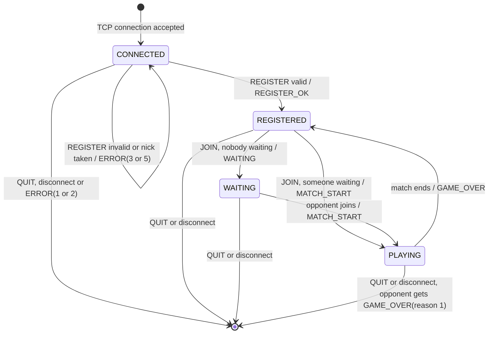
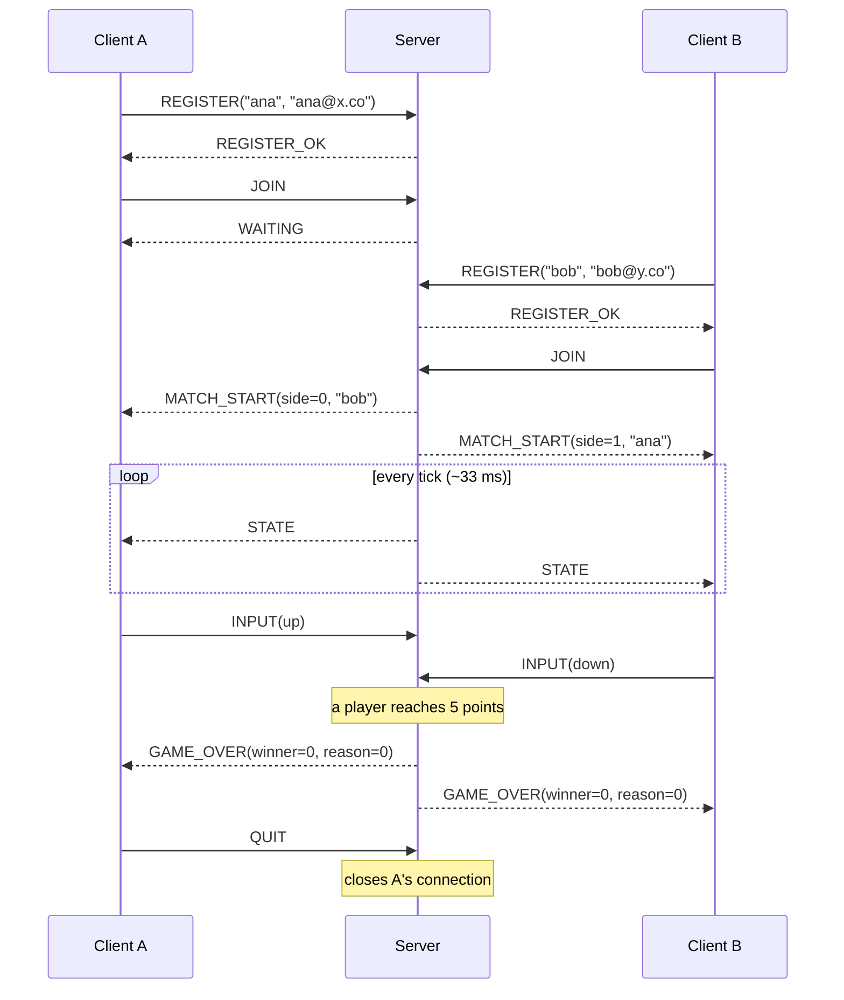
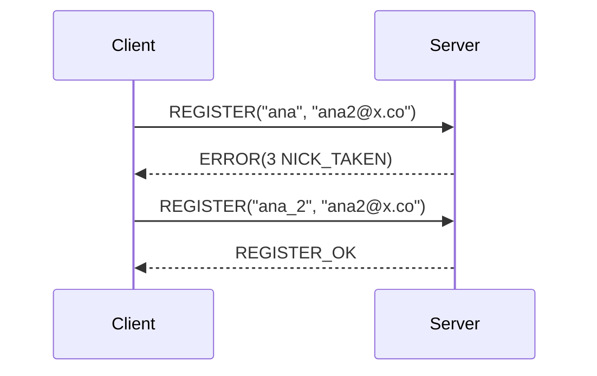
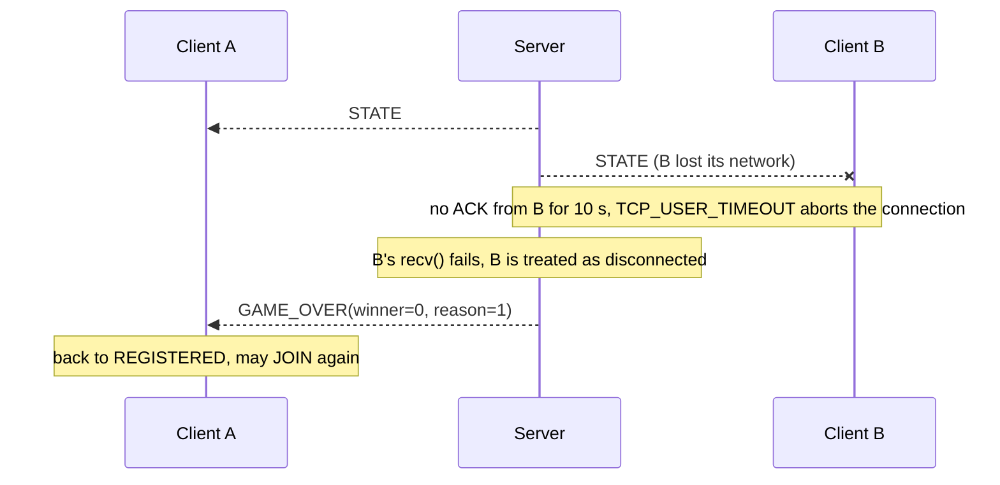

# Pong — Networked Game over PongProtocol

Project N1 · Internet: Architecture and Protocols

A client/server implementation of the classic **Pong** game. The server (**PongServer**, written in C with
Berkeley sockets and POSIX threads) keeps the authoritative game state for many simultaneous matches.
The clients (**PongClient**, Python + pygame) send the player's input and draw the state they receive.
Both sides talk through **PongProtocol**, a binary application-layer protocol designed for this project
and carried over TCP.

---

## 1. Introduction

*To be completed in the final phase.*

---

## 2. Development

### 2.1 Architecture

```
   PongClient A ──┐                    ┌──────────────── PongServer (C) ─────────────────┐
 (Python + pygame)│      TCP           │ main thread ── accept() loop                    │
                  ├───────────────────►│   └─ 1 client thread per connection             │
   PongClient B ──┘   PongProtocol     │ lobby ── pairs waiting players (FIFO)           │
                                       │   └─ 1 match thread per game (30 ticks/s)       │
                                       │ logger ── console + log file (thread-safe)      │
                                       └─────────────────────────────────────────────────┘
```

- **Main thread**: creates the listening socket and calls `accept()` forever. Every new connection gets its own thread.
- **Client thread**: blocks on `recv()`, decodes the client's messages and acts on them (registration, joining the queue, paddle input).
- **Match thread**: one per active game. Every tick it applies the inputs, moves the ball and paddles, detects collisions and goals, and sends the new state to both players.
- **Logger**: every relevant event (connections, registrations, matchmaking, goals, errors, disconnections) is printed to the console and appended to the log file under a mutex, so lines from different threads never mix.

**Why one thread per client?** `recv()` blocks: a thread waiting for one client cannot serve anyone else.
With a thread per client, each one waits only for its own client, so all players are served at the same
time. The alternative, a single thread multiplexing sockets with `select()`/`poll()`, scales better to
thousands of connections, but it is harder to follow. For the scale of this project (tens of players) threads
are enough, the assignment explicitly allows them, and each thread reads like a simple sequential program.

**Server source files (`server/`)**

| File | Responsibility |
|---|---|
| `main.c` | Listening socket, `accept()` loop, one detached thread per client. |
| `session.c` | What a client thread does: read messages, apply the state machine of 2.3.7, answer. Also the registry of connected nicknames (protected by a mutex). |
| `protocol.c` | PongProtocol v1 only: exact `send`/`recv` of bytes, header and payload encoding/decoding, validation. It knows nothing about threads or sessions. |
| `sockopts.c` | Options set on every client socket (`TCP_NODELAY`, keepalive, `TCP_USER_TIMEOUT`). |
| `player.c` | The `Player` object shared between threads, and `player_send()` (one writer at a time per socket). |
| `lobby.c` | Matchmaking queue: one waiting slot, first come, first served. |
| `game.c` | Matches: creation, the match thread (game loop and physics), and how a match ends. Owns `game_lock`. |

**Game loop (authoritative server).** Each match thread runs a fixed-timestep loop at 30 ticks/s:
take a snapshot of both players' last `INPUT` (under `game_lock`) → move the paddles (fixed speed, clamped
to the field) → move the ball, bounce it on the walls and paddles (the bounce angle depends on where it
hits the paddle, and every hit makes it 6% faster, up to a limit that keeps it from skipping over a
paddle) → detect goals → send `STATE` to both players. Ticks are scheduled on absolute deadlines
(`clock_nanosleep` with `TIMER_ABSTIME`), so the time spent simulating and sending never makes the game
drift slower. Clients only send *intentions* (up / down / stop), never positions. That is how the server
validates every move: a client simply cannot place its paddle or the ball anywhere. After each goal, the
ball waits ~0.7 s in the centre and is served toward the player who conceded.
| `logger.c` | Thread-safe logger (see 2.4). |

**Shared state and synchronization.** Several threads work on the same player: its own client thread,
the client thread of the player who pairs with it, and the match thread. Three mechanisms keep this safe:

| Mechanism | Protects | Why |
|---|---|---|
| `game_lock` (one global mutex) | The lobby's waiting slot, each player's state / match / side, every match | Pairing, leaving and state changes are *check-then-act* operations: without the lock, two players joining at the same moment could both be paired with the same waiting player. One lock is simple and enough here, because the critical sections are tiny and network sends happen outside it. |
| `send_lock` (one mutex per player) | Writing to that player's socket | The client thread, the lobby and the match thread may all send to the same client. The lock keeps the bytes of two messages from interleaving on the wire. |
| `refs` counter + condition variable | The lifetime of a `Player` | A match keeps using its players (it sends `GAME_OVER` to them). A client thread whose player is still referenced waits (`pthread_cond_wait`) before it ends. Otherwise the match could write to freed memory, or to a socket number the OS has already reused for a new client. |

Message order is guaranteed by design: `WAITING` is sent while `game_lock` is held, so no `MATCH_START`
can overtake it. The match thread is the only sender of `MATCH_START`, `STATE` and `GAME_OVER`.

### 2.2 Transport: why TCP

PongProtocol runs over **TCP (`SOCK_STREAM`)** only, with one connection per client.

| Concern | With TCP | With UDP |
|---|---|---|
| Control messages (`REGISTER`, `MATCH_START`, `GAME_OVER`…) | Delivered reliably and in order. Losing one would break the state machine. | We would have to reimplement acknowledgements, retransmissions and ordering. |
| Game state (`STATE`, 30 per second) | A lost segment delays the following ones (*head-of-line blocking*). | A lost packet could simply be skipped. |
| NAT / firewalls | The client opens the connection, so it works behind home routers. | The server must learn and keep each client's UDP address and port alive. |
| Complexity | One socket per client, one code path. | Two sockets (or a custom reliability layer). |

Our messages are tiny (`STATE` is 14 bytes, about 420 B/s per player), and packet loss on today's
Internet is low, so head-of-line blocking is rarely noticeable. In exchange we get a much simpler and more
robust protocol. Two TCP options adapt it to a real-time game:

- **`TCP_NODELAY`**: disables Nagle's algorithm, which would otherwise hold small messages for a while to group them. Every `STATE`/`INPUT` leaves immediately.
- **Dead-peer detection**: see [Liveness](#237-procedure-rules).

### 2.3 PongProtocol v1 specification

#### 2.3.1 Service

PongProtocol lets a client:

1. **Register** a player profile (nickname + e-mail) on the server.
2. **Join** the matchmaking queue and be paired with the next waiting player (first come, first served).
3. **Play** a match: the client sends its paddle *intention* (up / down / stop); the server, which is the only authority on the game state, simulates the match and broadcasts the state to both players 30 times per second.
4. Be **notified** when the match ends (a player reached 5 points, or the opponent left), and **join again** without reconnecting.
5. **Leave** at any time.

#### 2.3.2 Encoding rules

- Every message is a **4-byte header** followed by a **payload** of `length` bytes (0–255).
- All multi-byte integers are unsigned and in **network byte order (big-endian)**.
- Strings are **length-prefixed**: one `u8` with the length, then the bytes. There is no terminating `\0`. Characters are ASCII.
- Types: `u8` = 1 byte, `u16` = 2 bytes.

**Header**

| Offset | Size | Field | Description |
|---|---|---|---|
| 0 | u8 | `version` | Protocol version. Always `1`. |
| 1 | u8 | `type` | Message type (see vocabulary). |
| 2 | u16 | `length` | Payload size in bytes. Must be ≤ 255. |

**Framing.** TCP is a byte stream: one `recv()` can return part of a message, or several messages glued
together. The receiver always reads **exactly 4 bytes** (the header), then **exactly `length` bytes** (the
payload), looping on `recv()` until each part is complete.

#### 2.3.3 Message vocabulary

Types with the high bit set (`0x80`) are sent by the server.

| Type | Name | Direction | Payload size | Meaning |
|---|---|---|---|---|
| `0x01` | `REGISTER` | C → S | variable | Create my player profile. |
| `0x02` | `JOIN` | C → S | 0 | Put me in the matchmaking queue. |
| `0x03` | `INPUT` | C → S | 1 | My paddle direction changed. |
| `0x04` | `QUIT` | C → S | 0 | I am leaving; close the connection. |
| `0x81` | `REGISTER_OK` | S → C | 0 | Registration accepted. |
| `0x82` | `WAITING` | S → C | 0 | You are queued; waiting for an opponent. |
| `0x83` | `MATCH_START` | S → C | variable | A match begins: your side and your opponent. |
| `0x84` | `STATE` | S → C | 10 | Current positions and score (every tick). |
| `0x85` | `GAME_OVER` | S → C | 2 | The match ended. |
| `0xFF` | `ERROR` | S → C | 1 | Your last message was rejected. |

#### 2.3.4 Payload layouts

**`REGISTER` (0x01)**

| Offset | Size | Field | Rule |
|---|---|---|---|
| 0 | u8 | `nick_len` | 1–16 |
| 1 | `nick_len` | `nick` | letters, digits, `_` or `-` |
| 1 + n | u8 | `email_len` | 3–64 |
| 2 + n | `email_len` | `email` | printable ASCII, contains `@` |

The header's `length` must be exactly `2 + nick_len + email_len`.

**`INPUT` (0x03)**

| Offset | Size | Field | Values |
|---|---|---|---|
| 0 | u8 | `dir` | `0` = stop, `1` = up, `2` = down |

**`MATCH_START` (0x83)**

| Offset | Size | Field | Values |
|---|---|---|---|
| 0 | u8 | `side` | `0` = left paddle, `1` = right paddle |
| 1 | u8 | `opp_len` | 1–16 |
| 2 | `opp_len` | `opp_nick` | opponent's nickname |

**`STATE` (0x84)**: always 10 bytes.

| Offset | Size | Field | Description |
|---|---|---|---|
| 0 | u16 | `ball_x` | ball's top-left corner, x |
| 2 | u16 | `ball_y` | ball's top-left corner, y |
| 4 | u16 | `left_y` | left paddle's top edge, y |
| 6 | u16 | `right_y` | right paddle's top edge, y |
| 8 | u8 | `score_l` | left player's score |
| 9 | u8 | `score_r` | right player's score |

**`GAME_OVER` (0x85)**

| Offset | Size | Field | Values |
|---|---|---|---|
| 0 | u8 | `winner` | `0` = left, `1` = right |
| 1 | u8 | `reason` | `0` = a player reached the winning score, `1` = the opponent left |

**`ERROR` (0xFF)**

| Offset | Size | Field | Values |
|---|---|---|---|
| 0 | u8 | `code` | see error codes |

`JOIN`, `QUIT`, `REGISTER_OK` and `WAITING` have an empty payload (`length` = 0).

#### 2.3.5 Error codes

| Code | Name | When | Connection |
|---|---|---|---|
| 1 | `BAD_VERSION` | `version` ≠ 1 | **closed** |
| 2 | `BAD_MESSAGE` | unknown `type`, `length` > 255, or `length` doesn't match the message layout | **closed** |
| 3 | `NICK_TAKEN` | another connected player already uses that nickname | stays open (client may retry) |
| 4 | `INVALID_STATE` | the message isn't allowed in the client's current state | stays open (message ignored) |
| 5 | `INVALID_FIELD` | a field breaks its rule (e.g. empty nick, e-mail without `@`, `dir` > 2) | stays open (message ignored) |

Codes 1 and 2 close the connection because, after a malformed header, the receiver can no longer tell
where the next message starts: the byte stream is out of sync.

**Validation order.** The server checks every incoming message in this order and answers with the first
error it finds:

1. `version` ≠ 1 → `ERROR(1)`.
2. `length` > 255 → `ERROR(2)`.
3. `type` is not a message a client may send → `ERROR(2)`. (Up to here the payload is **not** read.)
4. The message is not allowed in the client's state → `ERROR(4)`, except a late `INPUT` (rule 7 in 2.3.7).
5. The payload does not fit the message layout (e.g. `length` ≠ 2 + `nick_len` + `email_len`, or a non-empty `JOIN`/`QUIT`) → `ERROR(2)`.
6. A field breaks its rule (2.3.4) → `ERROR(5)`.

When the server closes the connection after `ERROR(1)` or `ERROR(2)`, it first stops sending
(`shutdown`) and discards, for at most about 3 seconds, whatever the client is still sending. Closing a
socket that has unread incoming data makes Linux reset the connection (RST), and the client could lose
the `ERROR` message that was just sent.

#### 2.3.6 Game constants

Both applications use these fixed values. They are part of the specification and are never sent.

| Constant | Value |
|---|---|
| Field size | 800 × 600 units. Origin at the top-left corner, x grows right, y grows down. |
| Paddle size | 10 × 80. Left paddle at x = 20, right paddle at x = 770. |
| Ball size | 10 × 10 |
| Tick rate | 30 ticks/s: one `STATE` to each player every ~33 ms |
| Winning score | 5 |

Positions are integers, so we never have to serialize floating-point numbers. The server is free to
simulate internally with more precision. `ball_y` is always in 0–590 and the paddles in 0–520. `ball_x`
is normally in 0–790, but when the ball leaves the field after a goal it may briefly be partly outside:
values up to 800 are sent, and negative values are sent as 0.

#### 2.3.7 Procedure rules

**States (server's view of each client)**

| State | Allowed client messages | Anything else |
|---|---|---|
| `CONNECTED` | `REGISTER`, `QUIT` | `ERROR(4)` |
| `REGISTERED` | `JOIN`, `QUIT` | `ERROR(4)` |
| `WAITING` | `QUIT` | `ERROR(4)` |
| `PLAYING` | `INPUT`, `QUIT` | `ERROR(4)` |



**Rules**

1. **Registration first.** A client must register before anything else. The nickname must be unique among *connected* players, **ignoring upper/lower case** (`ana` and `Ana` are the same nickname). Profiles live in memory and are released when the client disconnects.
2. **Matchmaking.** On `JOIN`, if another player is waiting, both are paired at once and receive `MATCH_START`. Otherwise the client receives `WAITING` and is paired with the next player who joins.
3. **Authoritative server.** `INPUT` only changes the paddle's *direction*. The server moves the paddle at its own fixed speed, keeps it inside the field, moves the ball, detects collisions and goals, and keeps the score. Clients never send positions.
4. **State broadcast.** During a match, the server sends `STATE` to both players every tick. The client sends `INPUT` only when the direction **changes** (not every frame).
5. **End of match.** When a player reaches 5 points, both receive `GAME_OVER(winner, 0)` and return to `REGISTERED`. They may `JOIN` again on the same connection.
6. **Opponent leaves.** If a player sends `QUIT`, disconnects, or is detected as dead during a match, the opponent receives `GAME_OVER(opponent's side, 1)` and returns to `REGISTERED`.
7. **Late input.** An `INPUT` received outside `PLAYING` is **silently discarded**, not answered with an error. It may legitimately cross a `GAME_OVER` that is already on its way to the client.
8. **Leaving.** After `QUIT` the server closes the connection. A player who quits while `WAITING` is removed from the queue.
9. **Errors.** See error codes: protocol violations (1, 2) close the connection; semantic errors (3, 4, 5) are reported and the message is ignored.

**Liveness (dead-peer detection)**

A client can disappear without closing its connection: it loses Wi-Fi, switches networks, or its machine
crashes. Since TCP sends nothing on an idle connection, the server would wait in `recv()` forever. A
"ghost" player would then stay in the queue, or freeze a match. PongProtocol has no heartbeat message.
Instead, the server configures every client socket with:

| Socket option | Value | Covers |
|---|---|---|
| `SO_KEEPALIVE` + `TCP_KEEPIDLE` / `TCP_KEEPINTVL` / `TCP_KEEPCNT` | 5 s / 2 s / 3 probes | idle connections (registered or waiting players): the kernel probes a silent peer |
| `TCP_USER_TIMEOUT` | 10 s | active connections (during a match): data sent but not acknowledged for 10 s aborts the connection |

A dead client is detected within about 15 s. Its `recv()` then fails, and the server treats it exactly like
a disconnection (rules 6 and 8). Trade-off: these options are part of the operating system (Linux), not of
the protocol messages. The protocol stays smaller, but the behaviour depends on the server's socket
configuration.

#### 2.3.8 Sequence diagrams

**Normal flow: register, match, game over, leave**



**Nickname already taken, then retry**



**Opponent disappears mid-match**



#### 2.3.9 Byte-level example

`REGISTER("ana", "ana@x.co")` is 17 bytes on the wire:

```
01             version   = 1
01             type      = 0x01 REGISTER
00 0D          length    = 13 (big-endian) = 1 + 3 + 1 + 8
03             nick_len  = 3
61 6E 61       nick      = "ana"
08             email_len = 8
61 6E 61 40 78 2E 63 6F   email = "ana@x.co"
```

### 2.4 Logger

Every line has the format `YYYY-MM-DD HH:MM:SS [LEVEL] message`, with `LEVEL` ∈ {`INFO`, `WARN`, `ERROR`}.
Messages related to a client start with its `ip:port`. The same line goes to the console and to the log file.

For every client message the server logs the raw bytes in hexadecimal (`RECV <TYPE> [bytes]`), then what
it decoded, then what it answered (`SEND <TYPE>`). The hex can be compared byte by byte with the spec in
2.3.9 or with `tcpdump`. Text fields (nickname, e-mail) are written to the log only after they pass
validation, so a client cannot inject fake lines into the log with line breaks or control characters.
High-frequency messages (`STATE`) are not logged. Instead, the log tells the story of every match:

```
2026-10-20 23:40:47 [INFO] match started: 'left1' (left, 127.0.0.1:44906) vs 'right1' (right, 127.0.0.1:44920)
2026-10-20 23:40:53 [INFO] goal: 'left1' scores (1-0) in 'left1' vs 'right1'
2026-10-20 23:41:13 [INFO] goal: 'right1' scores (3-1) in 'left1' vs 'right1'
2026-10-20 23:41:37 [INFO] goal: 'left1' scores (5-2) in 'left1' vs 'right1'
2026-10-20 23:41:37 [INFO] match 'left1' vs 'right1' over: winner=left1 (score)
```

```
2026-10-11 17:26:35 [INFO] 127.0.0.1:36974 connected
2026-10-11 17:26:35 [INFO] 127.0.0.1:36974 RECV REGISTER [01 01 00 11 03 61 6e 61 0c 61 6e 61 40 74 65 73 74 2e 63 6f 6d]
2026-10-11 17:26:35 [INFO] 127.0.0.1:36974 REGISTER nick=ana email=ana@test.com
2026-10-11 17:26:35 [INFO] 127.0.0.1:36974 registered as 'ana'
2026-10-11 17:26:35 [INFO] 127.0.0.1:36974 SEND REGISTER_OK
2026-10-11 17:26:35 [WARN] 127.0.0.1:36986 rejected: nickname 'ANA' is already in use
2026-10-11 17:26:35 [INFO] 127.0.0.1:36986 SEND ERROR code=3 (NICK_TAKEN)
2026-10-11 17:26:39 [WARN] 127.0.0.1:37012 rejected: unsupported protocol version 104
```

### 2.5 Build and run

**Server** (Linux, gcc, make):

```bash
cd server
make
./server <PORT> <LogFile>      # e.g. ./server 5000 pong.log
```

**Test bot** (Python 3, standard library only, no window):

```bash
cd client
python bot.py --nick ana                        # register, print the server's reply, send QUIT
python bot.py --nick ana --hold 20              # stay registered for 20 s before QUIT
python bot.py --nick ana --join --hold 30       # JOIN the queue and print what arrives for 30 s
python bot.py --nick ana --play                 # JOIN and play a whole match automatically
python bot.py --nick ana --host 1.2.3.4 --port 5000 --email ana@x.co
```

With `--play`, the bot moves its paddle toward the ball (with a random aiming error, so goals happen),
sends `INPUT` only when its direction changes, and leaves after `GAME_OVER`. Two `--play` bots play a
whole match in about a minute. The test campaign used 20 bots at once (10 simultaneous matches).

Run `bot.py --nick ana --hold 20` and, meanwhile, a second `bot.py --nick ANA`: the second one receives
`ERROR code=3 (NICK_TAKEN)`.

Run two bots with `--join --hold 30` at the same time: the first receives `WAITING`, then both receive
`MATCH_START` with opposite sides. Stop one of them with Ctrl+C: the other receives
`GAME_OVER winner=… reason=1 (opponent left)`.

**Inspecting the protocol by hand** (Linux). A garbage message gets `ERROR(1)` and the connection is
closed, but the server keeps running:

```bash
printf 'hola\n' | nc -N localhost 5000 | xxd    # -> 01ff 0001 01
sudo tcpdump -i lo -X -nn port 5000             # raw bytes of a bot session (run the bot from the same machine)
```

**Pong client (pygame)**: *to be completed (Phase 7).*

---

## 3. Conclusions

*To be completed in the final phase.*

---

## 4. References

- B. Hall, *Beej's Guide to Network Programming*. https://beej.us/guide/bgnet/
- B. Hall, *Beej's Guide to C Programming*. https://beej.us/guide/bgc/
- GeeksforGeeks, *TCP Server-Client implementation in C*. https://www.geeksforgeeks.org/tcp-server-client-implementation-in-c/
- W. Eddy, *RFC 9293: Transmission Control Protocol (TCP)*, IETF, 2022.
- *Pong*. Wikipedia. https://en.wikipedia.org/wiki/Pong
- Linux man pages: `socket(7)`, `tcp(7)`, `pthreads(7)`.