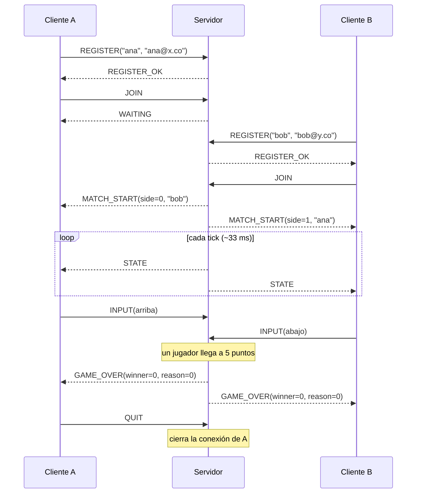
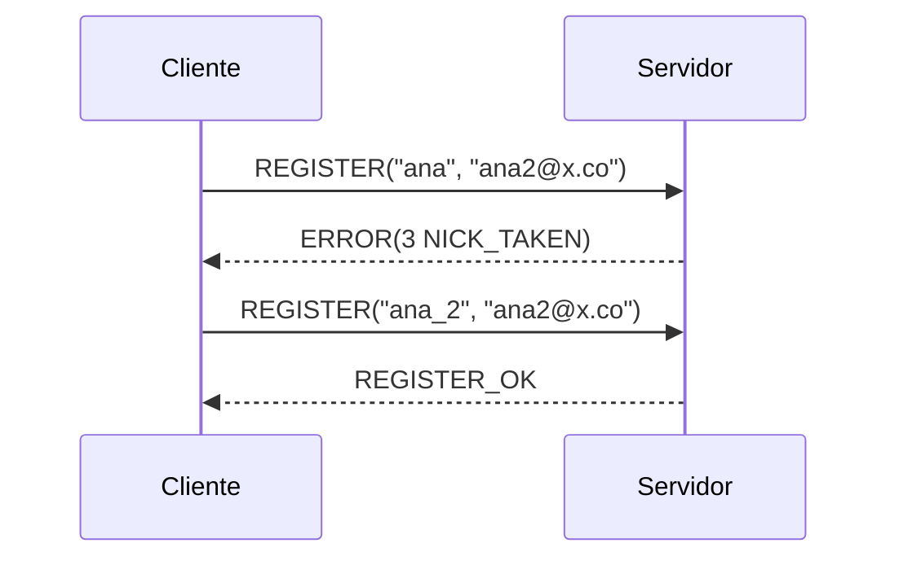
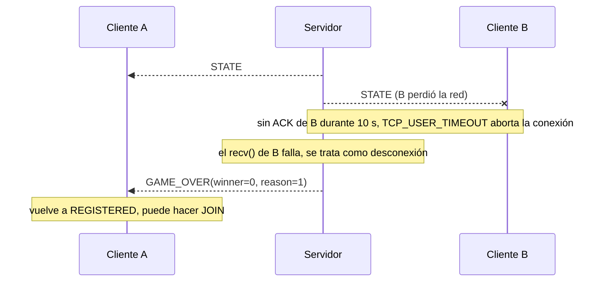

# Pong en red sobre PongProtocol

Proyecto N1 · Internet: Arquitectura y Protocolos

Implementación cliente/servidor del Pong clásico. El servidor (**PongServer**) está escrito en C con
sockets Berkeley e hilos POSIX y guarda el estado de todas las partidas. Los clientes (**PongClient**,
Python + pygame) solo envían lo que el jugador quiere hacer y dibujan lo que el servidor les cuenta.
Ambos hablan **PongProtocol**, un protocolo binario de capa de aplicación que diseñamos para este
proyecto y que viaja sobre TCP.

---

## 1. Introducción

El objetivo del proyecto era diseñar un protocolo de aplicación propio y probarlo con una aplicación
real que usara sockets. Escogimos Pong porque es un juego de dos jugadores con reglas pequeñas, pero
obliga a resolver los problemas típicos de una aplicación en red: registrar usuarios, emparejarlos,
mantener un estado compartido que cambia 30 veces por segundo, y reaccionar cuando alguien se
desconecta sin avisar.

Lo que ofrece el sistema:

- Registro de un jugador con nickname y correo.
- Emparejamiento automático: el primero que espera juega con el siguiente que llega.
- Partidas simultáneas, cada una a 30 ticks por segundo, hasta que alguien llega a 5 puntos.
- Notificación al terminar la partida y posibilidad de jugar otra vez sin reconectarse.
- Detección de clientes caídos y manejo de mensajes mal formados.

---

## 2. Desarrollo

### 2.1 Arquitectura

```
   PongClient A ──┐                    ┌──────────────── PongServer (C) ─────────────────┐
 (Python + pygame)│      TCP           │ hilo principal ── accept()                      │
                  ├───────────────────►│   └─ 1 hilo por cliente conectado               │
   PongClient B ──┘   PongProtocol     │ lobby ── empareja jugadores en espera           │
                                       │   └─ 1 hilo por partida (30 ticks/s)            │
                                       │ logger ── consola + archivo (con mutex)         │
                                       └─────────────────────────────────────────────────┘
```

- **Hilo principal:** crea el socket de escucha y llama a `accept()` en un ciclo. Cada conexión nueva
  recibe su propio hilo.
- **Hilo de cliente:** se queda en `recv()`, decodifica lo que llega y actúa (registro, entrar a la
  cola, movimiento de la paleta).
- **Hilo de partida:** uno por cada juego activo. En cada tick aplica los inputs, mueve la bola,
  detecta choques y goles, y envía el estado a los dos jugadores.
- **Logger:** todo evento relevante sale por consola y se agrega al archivo de log, protegido con un
  mutex para que las líneas de distintos hilos no se mezclen.

Elegimos un hilo por cliente porque `recv()` bloquea y así cada jugador se atiende por separado, con
código secuencial fácil de seguir. Pensamos en `select()`/`poll()`, que escala mejor, pero para las
decenas de jugadores que espera este proyecto no valía la pena la complejidad extra, y el enunciado
permite hilos.

**Archivos del servidor (`server/`)**

| Archivo | Qué hace |
|---|---|
| `main.c` | Socket de escucha, ciclo de `accept()` y un hilo por cliente. |
| `session.c` | Lo que hace el hilo de un cliente: leer mensajes, aplicar la máquina de estados (2.3.7) y responder. Aquí también está el registro de nicknames. |
| `protocol.c` | Solo el protocolo: enviar y recibir bytes exactos, codificar y decodificar cabeceras y payloads, validar. No sabe nada de hilos ni de sesiones. |
| `sockopts.c` | Opciones de cada socket de cliente (`TCP_NODELAY`, keepalive, `TCP_USER_TIMEOUT`). |
| `player.c` | El objeto `Player` que comparten varios hilos y `player_send()`. |
| `lobby.c` | Cola de emparejamiento: un solo puesto de espera, primero en llegar, primero en jugar. |
| `game.c` | Creación y vida de las partidas, hilo de juego, física y fin de partida. Aquí vive `game_lock`. |
| `logger.c` | Logger seguro entre hilos (ver 2.4). |

**Ciclo de juego.** El servidor es la única autoridad. Cada partida corre un ciclo de paso fijo a 30
ticks/s: toma una copia de la última dirección pedida por cada jugador (bajo `game_lock`), mueve las
paletas a velocidad fija sin salirse de la cancha, mueve la bola, la hace rebotar en paredes y
paletas, revisa goles y manda `STATE` a ambos. Los clientes solo envían intenciones (subir, bajar,
parar), nunca posiciones, así que ninguno puede mover su paleta o la bola a donde quiera.

Detalles de la física:

- El ángulo de rebote depende de en qué parte de la paleta pega la bola.
- Cada golpe aumenta la velocidad un 6 %, con un tope (16) menor que `PADDLE_W + BALL_SIZE`. Si no, la
  bola podría atravesar una paleta de un tick a otro.
- Después de cada gol la bola espera unos 0,7 s en el centro y se saca hacia quien recibió el gol.
- Los ticks se programan con plazos absolutos (`clock_nanosleep` con `TIMER_ABSTIME`). Un `sleep` de
  33 ms hubiera hecho el juego más lento, porque simular y enviar también toman tiempo.

**Estado compartido y sincronización.** Sobre un mismo jugador pueden actuar tres hilos a la vez: el
suyo, el del jugador que lo empareja y el de la partida. Usamos tres mecanismos:

| Mecanismo | Protege | Por qué |
|---|---|---|
| `game_lock` (un mutex global) | La cola, el estado de cada jugador y todas las partidas | Emparejar y salir son operaciones de "mirar y luego actuar". Sin el lock, dos jugadores que entran al mismo tiempo podrían emparejarse con el mismo jugador en espera. Las secciones críticas son cortas y los envíos por red se hacen fuera del lock (con una excepción, ver abajo). |
| `send_lock` (uno por jugador) | Escritura en su socket | El hilo del cliente, la cola y la partida pueden enviarle mensajes. El lock evita que los bytes de dos mensajes se entremezclen. |
| contador `refs` + variable de condición | La vida del `Player` | Una partida sigue usando a sus jugadores incluso para mandar `GAME_OVER`. Si el hilo del cliente terminara antes, la partida escribiría en memoria liberada o en un descriptor que el sistema ya reasignó. Por eso ese hilo espera con `pthread_cond_wait` hasta que `refs` llega a 0. |

La excepción: `WAITING` se envía con `game_lock` tomado. Así ningún `MATCH_START` puede adelantarlo, y
el cliente siempre ve `WAITING` y después `MATCH_START`. Son 4 bytes en un socket vacío, así que el
`send()` no bloquea. Después, el único que envía `MATCH_START`, `STATE` y `GAME_OVER` es el hilo de la
partida.

### 2.2 Transporte: por qué TCP

PongProtocol usa solo **TCP (`SOCK_STREAM`)**, con una conexión por cliente.

| Aspecto | TCP | UDP |
|---|---|---|
| Mensajes de control (`REGISTER`, `MATCH_START`, `GAME_OVER`…) | Llegan completos y en orden. Perder uno rompería la máquina de estados. | Habría que implementar confirmaciones, reenvíos y orden. |
| Estado del juego (`STATE`, 30 por segundo) | Un segmento perdido retrasa los siguientes (*head-of-line blocking*). | Un paquete perdido se podría ignorar. |
| NAT y firewalls | El cliente abre la conexión, así que funciona detrás de un router casero. | El servidor tendría que recordar y mantener viva la dirección UDP de cada cliente. |
| Complejidad | Un socket por cliente y un solo camino de código. | Dos sockets o una capa propia de fiabilidad. |

Nuestros mensajes son pequeños (un `STATE` ocupa 14 bytes con cabecera, unos 420 B/s por jugador) y
en redes actuales la pérdida de paquetes es baja, así que el bloqueo por pérdida casi no se nota. A
cambio, el protocolo queda mucho más simple. Para que TCP se comporte mejor en un juego en tiempo real
activamos `TCP_NODELAY`, que desactiva el algoritmo de Nagle (el que retiene mensajes pequeños para
agruparlos), de modo que cada `STATE` e `INPUT` sale de inmediato.

### 2.3 Especificación de PongProtocol v1

#### 2.3.1 Servicio

Con PongProtocol un cliente puede:

1. **Registrarse** con nickname y correo.
2. **Entrar a la cola** de emparejamiento y jugar contra el siguiente que espere.
3. **Jugar:** envía la dirección de su paleta (arriba, abajo, quieto). El servidor simula el juego y
   envía el estado a ambos jugadores 30 veces por segundo.
4. **Enterarse del fin de la partida** (alguien llegó a 5 puntos o el rival se fue) y volver a
   entrar a la cola sin reconectarse.
5. **Salir** en cualquier momento.

#### 2.3.2 Reglas de codificación

- Todo mensaje es una **cabecera de 4 bytes** seguida de un **payload** de `length` bytes (0 a 255).
- Los enteros de más de un byte son sin signo y van en **orden de red (big-endian)**.
- Los textos llevan su longitud antes: un `u8` con el largo y luego los bytes. No hay `\0` final.
  Solo ASCII.
- Tipos: `u8` = 1 byte, `u16` = 2 bytes.

Los números van como enteros y nunca como flotantes, así evitamos serializar `float`. El servidor
simula con `double` internamente y redondea al enviar.

**Cabecera**

| Offset | Tamaño | Campo | Descripción |
|---|---|---|---|
| 0 | u8 | `version` | Versión del protocolo. Siempre `1`. |
| 1 | u8 | `type` | Tipo de mensaje. |
| 2 | u16 | `length` | Tamaño del payload en bytes, máximo 255. |

**Delimitación de mensajes.** TCP entrega un flujo de bytes: un `recv()` puede traer la mitad de un
mensaje o varios pegados. Por eso el receptor siempre lee **exactamente 4 bytes** (la cabecera) y
después **exactamente `length` bytes**, repitiendo `recv()` hasta completar cada parte.

#### 2.3.3 Vocabulario de mensajes

Los tipos con el bit alto en 1 (`0x80`) los envía el servidor.

| Tipo | Nombre | Dirección | Payload | Significado |
|---|---|---|---|---|
| `0x01` | `REGISTER` | C → S | variable | Crear mi perfil. |
| `0x02` | `JOIN` | C → S | 0 | Ponerme en la cola. |
| `0x03` | `INPUT` | C → S | 1 | Cambió la dirección de mi paleta. |
| `0x04` | `QUIT` | C → S | 0 | Me voy; cierra la conexión. |
| `0x81` | `REGISTER_OK` | S → C | 0 | Registro aceptado. |
| `0x82` | `WAITING` | S → C | 0 | Estás en cola, esperando rival. |
| `0x83` | `MATCH_START` | S → C | variable | Empieza la partida: tu lado y tu rival. |
| `0x84` | `STATE` | S → C | 10 | Posiciones y marcador (en cada tick). |
| `0x85` | `GAME_OVER` | S → C | 2 | Terminó la partida. |
| `0xFF` | `ERROR` | S → C | 1 | Tu último mensaje fue rechazado. |

#### 2.3.4 Estructura de los payloads

**`REGISTER` (0x01)**

| Offset | Tamaño | Campo | Regla |
|---|---|---|---|
| 0 | u8 | `nick_len` | 1–16 |
| 1 | `nick_len` | `nick` | letras, dígitos, `_` o `-` |
| 1 + n | u8 | `email_len` | 3–64 |
| 2 + n | `email_len` | `email` | ASCII imprimible, con `@` |

El `length` de la cabecera debe ser exactamente `2 + nick_len + email_len`.

**`INPUT` (0x03):** un byte `dir`: `0` = quieto, `1` = arriba, `2` = abajo.

**`MATCH_START` (0x83)**

| Offset | Tamaño | Campo | Valores |
|---|---|---|---|
| 0 | u8 | `side` | `0` = paleta izquierda, `1` = derecha |
| 1 | u8 | `opp_len` | 1–16 |
| 2 | `opp_len` | `opp_nick` | nickname del rival |

**`STATE` (0x84):** siempre 10 bytes.

| Offset | Tamaño | Campo | Descripción |
|---|---|---|---|
| 0 | u16 | `ball_x` | esquina superior izquierda de la bola, x |
| 2 | u16 | `ball_y` | esquina superior izquierda de la bola, y |
| 4 | u16 | `left_y` | borde superior de la paleta izquierda |
| 6 | u16 | `right_y` | borde superior de la paleta derecha |
| 8 | u8 | `score_l` | puntos del jugador izquierdo |
| 9 | u8 | `score_r` | puntos del jugador derecho |

**`GAME_OVER` (0x85):** `winner` (u8: `0` izquierda, `1` derecha) y `reason` (u8: `0` alguien llegó
al puntaje, `1` el rival se fue).

**`ERROR` (0xFF):** un byte `code` (ver 2.3.5).

`JOIN`, `QUIT`, `REGISTER_OK` y `WAITING` no llevan payload (`length` = 0).

#### 2.3.5 Códigos de error

| Código | Nombre | Cuándo | Conexión |
|---|---|---|---|
| 1 | `BAD_VERSION` | `version` ≠ 1 | **se cierra** |
| 2 | `BAD_MESSAGE` | tipo desconocido, `length` > 255 o que no coincide con la estructura | **se cierra** |
| 3 | `NICK_TAKEN` | otro jugador conectado ya usa ese nickname | sigue abierta, puede reintentar |
| 4 | `INVALID_STATE` | el mensaje no se permite en el estado actual | sigue abierta, se ignora el mensaje |
| 5 | `INVALID_FIELD` | un campo rompe su regla (nick vacío, correo sin `@`, `dir` > 2) | sigue abierta, se ignora el mensaje |

Los códigos 1 y 2 cierran la conexión porque, tras una cabecera mala, el receptor ya no sabe dónde
empieza el siguiente mensaje: el flujo quedó desincronizado.

**Orden de validación.** El servidor revisa cada mensaje en este orden y responde con el primer error:

1. `version` ≠ 1 → `ERROR(1)`.
2. `length` > 255 → `ERROR(2)`.
3. `type` que un cliente no puede enviar → `ERROR(2)`. Hasta aquí no se lee el payload.
4. Mensaje no permitido en el estado actual → `ERROR(4)` (excepto un `INPUT` tardío, regla 7).
5. El payload no calza con la estructura (por ejemplo `length` ≠ `2 + nick_len + email_len`, o un
   `JOIN`/`QUIT` con payload) → `ERROR(2)`.
6. Un campo rompe su regla → `ERROR(5)`.

**Cierre con "lingering".** Cuando el servidor cierra tras un `ERROR(1)` o `ERROR(2)`, primero hace
`shutdown(SHUT_WR)` y lee y descarta durante unos 3 s lo que el cliente siga enviando. Si se hace
`close()` con datos sin leer, Linux manda un RST y el cliente puede perder el `ERROR` que acabamos de
enviarle.

#### 2.3.6 Constantes del juego

Ambas aplicaciones usan estos valores fijos. Son parte de la especificación y nunca se envían.

| Constante | Valor |
|---|---|
| Cancha | 800 × 600. Origen arriba a la izquierda, x crece a la derecha, y hacia abajo. |
| Paleta | 10 × 80. Izquierda en x = 20, derecha en x = 770. |
| Bola | 10 × 10 |
| Tick | 30 por segundo: un `STATE` a cada jugador cada ~33 ms |
| Puntaje para ganar | 5 |

`ball_y` siempre está entre 0 y 590 y las paletas entre 0 y 520. `ball_x` normalmente va de 0 a 790,
pero tras un gol la bola puede salirse un poco de la cancha: se envían valores hasta 800 y los
negativos se envían como 0.

#### 2.3.7 Reglas de procedimiento

**Estados (vista del servidor)**

| Estado | Mensajes permitidos | Cualquier otro |
|---|---|---|
| `CONNECTED` | `REGISTER`, `QUIT` | `ERROR(4)` |
| `REGISTERED` | `JOIN`, `QUIT` | `ERROR(4)` |
| `WAITING` | `QUIT` | `ERROR(4)` |
| `PLAYING` | `INPUT`, `QUIT` | `ERROR(4)` |


**Reglas**

1. **Primero registrarse.** El nickname debe ser único entre los jugadores *conectados*, sin distinguir
   mayúsculas (`ana` y `Ana` son el mismo). Los perfiles viven en memoria y se liberan al desconectarse.
2. **Emparejamiento.** En `JOIN`, si hay alguien esperando se emparejan de inmediato y ambos reciben
   `MATCH_START`. Si no, el cliente recibe `WAITING`. Quien esperó más juega a la izquierda.
3. **Servidor autoritativo.** `INPUT` solo cambia la *dirección* de la paleta. El servidor la mueve a
   su velocidad, la mantiene dentro de la cancha, mueve la bola y lleva el marcador.
4. **Difusión del estado.** Durante la partida el servidor envía `STATE` a ambos en cada tick. El
   cliente envía `INPUT` solo cuando la dirección **cambia**, no en cada cuadro.
5. **Fin de partida.** Cuando alguien llega a 5, ambos reciben `GAME_OVER(winner, 0)` y vuelven a
   `REGISTERED`. Pueden hacer `JOIN` otra vez en la misma conexión.
6. **El rival se va.** Si un jugador envía `QUIT`, se desconecta o se detecta como caído, el rival
   recibe `GAME_OVER(su propio lado, 1)` y vuelve a `REGISTERED`.
7. **`INPUT` tardío.** Un `INPUT` recibido fuera de `PLAYING` se descarta en silencio, sin error.
   Puede ser legítimo: pudo cruzarse con un `GAME_OVER` que ya iba en camino.
8. **Salir.** Tras `QUIT` el servidor cierra la conexión. Quien sale estando en `WAITING` se saca de
   la cola.
9. **Errores.** Los de protocolo (1 y 2) cierran la conexión. Los semánticos (3, 4 y 5) se avisan y
   el mensaje se ignora.

**Detección de clientes caídos**

Un cliente puede desaparecer sin cerrar la conexión (se cae el Wi-Fi, se apaga el equipo). Como TCP no
envía nada en una conexión inactiva, el servidor se quedaría esperando en `recv()` para siempre, y un
jugador fantasma ocuparía la cola o congelaría una partida. PongProtocol no tiene un mensaje de
*heartbeat*; en su lugar configuramos cada socket del cliente así:

| Opción | Valor | Cubre |
|---|---|---|
| `SO_KEEPALIVE` + `TCP_KEEPIDLE` / `TCP_KEEPINTVL` / `TCP_KEEPCNT` | 5 s / 2 s / 3 sondeos | conexiones inactivas (registrado o esperando): el kernel sondea al cliente en silencio |
| `TCP_USER_TIMEOUT` | 10 s | conexiones activas (durante la partida): si lo enviado no se confirma en 10 s, se aborta |

Así un cliente caído se detecta en unos 10 a 15 s. Su `recv()` falla y el servidor lo trata igual que
una desconexión (reglas 6 y 8). La contrapartida es que este comportamiento depende del sistema
operativo (Linux) y no de los mensajes del protocolo.

#### 2.3.8 Diagramas de secuencia

**Flujo normal: registro, partida, fin y salida**



**Nickname repetido y reintento**



**El rival desaparece durante la partida**



#### 2.3.9 Ejemplo byte a byte

`REGISTER("ana", "ana@x.co")` ocupa 17 bytes en la red:

```
01             version   = 1
01             type      = 0x01 REGISTER
00 0D          length    = 13 (big-endian) = 1 + 3 + 1 + 8
03             nick_len  = 3
61 6E 61       nick      = "ana"
08             email_len = 8
61 6E 61 40 78 2E 63 6F   email = "ana@x.co"
```

### 2.4 Logger

Cada línea tiene el formato `AAAA-MM-DD HH:MM:SS [NIVEL] mensaje`, con nivel `INFO`, `WARN` o `ERROR`.
Los mensajes de un cliente empiezan con su `ip:puerto`, y la misma línea sale por consola y por el
archivo.

Por cada mensaje de un cliente se registra el volcado hexadecimal (`RECV <TIPO> [bytes]`), luego lo
que se decodificó y luego lo que se respondió (`SEND <TIPO>`). Ese hex se puede comparar byte a byte
con 2.3.9 o con `tcpdump`. Los textos (nickname, correo) solo se escriben en el log después de
validarlos, para que un cliente no pueda inyectar líneas falsas con saltos de línea o caracteres de
control. Los `STATE` no se registran (son 30 por segundo); en su lugar el log cuenta la historia de
cada partida:

```
2026-10-20 23:40:47 [INFO] match started: 'left1' (left, 127.0.0.1:44906) vs 'right1' (right, 127.0.0.1:44920)
2026-10-20 23:40:53 [INFO] goal: 'left1' scores (1-0) in 'left1' vs 'right1'
2026-10-20 23:41:13 [INFO] goal: 'right1' scores (3-1) in 'left1' vs 'right1'
2026-10-20 23:41:37 [INFO] goal: 'left1' scores (5-2) in 'left1' vs 'right1'
2026-10-20 23:41:37 [INFO] match 'left1' vs 'right1' over: winner=left1 (score)
```

```
2026-10-11 17:26:35 [INFO] 127.0.0.1:36974 connected
2026-10-11 17:26:35 [INFO] 127.0.0.1:36974 RECV REGISTER [01 01 00 11 03 61 6e 61 0c 61 6e 61 40 74 65 73 74 2e 63 6f 6d]
2026-10-11 17:26:35 [INFO] 127.0.0.1:36974 REGISTER nick=ana email=ana@test.com
2026-10-11 17:26:35 [INFO] 127.0.0.1:36974 registered as 'ana'
2026-10-11 17:26:35 [INFO] 127.0.0.1:36974 SEND REGISTER_OK
2026-10-11 17:26:35 [WARN] 127.0.0.1:36986 rejected: nickname 'ANA' is already in use
2026-10-11 17:26:35 [INFO] 127.0.0.1:36986 SEND ERROR code=3 (NICK_TAKEN)
2026-10-11 17:26:39 [WARN] 127.0.0.1:37012 rejected: unsupported protocol version 104
```

### 2.5 Compilar y ejecutar

**Servidor** (Linux, gcc, make):

```bash
cd server
make
./server <PUERTO> <ArchivoLog>      # por ejemplo: ./server 5000 pong.log
```

El puerto debe estar entre 1024 y 65535.

**Bot de pruebas** (Python 3, solo librería estándar, sin ventana):

```bash
cd client
python bot.py --nick ana                        # se registra, imprime la respuesta y envía QUIT
python bot.py --nick ana --hold 20              # se queda registrado 20 s antes del QUIT
python bot.py --nick ana --join --hold 30       # hace JOIN e imprime lo que llegue durante 30 s
python bot.py --nick ana --play                 # hace JOIN y juega una partida completa solo
python bot.py --nick ana --host 1.2.3.4 --port 5000 --email ana@x.co
```

Con `--play` el bot mueve su paleta hacia la bola con un error de puntería aleatorio (para que haya
goles) y envía `INPUT` solo cuando cambia de dirección. Dos bots con `--play` juegan una partida
completa en más o menos un minuto.

Pruebas manuales que sirven para ver el protocolo en acción:

- **Nickname repetido:** deja `bot.py --nick ana --hold 20` corriendo y lanza `bot.py --nick ANA`. El
  segundo recibe `ERROR code=3 (NICK_TAKEN)`.
- **Emparejamiento:** corre dos bots con `--join --hold 30`. El primero recibe `WAITING` y luego los
  dos reciben `MATCH_START` con lados opuestos.
- **Rival que se va:** detén uno con Ctrl+C. El otro recibe `GAME_OVER ... reason=1`.

**Inspección a mano** (Linux). Un mensaje basura recibe `ERROR(1)` y la conexión se cierra, pero el
servidor sigue en pie:

```bash
printf 'hola\n' | nc -N localhost 5000 | xxd    # -> 01ff 0001 01
sudo tcpdump -i lo -X -nn port 5000             # bytes crudos de una sesión del bot
```

**Cliente con ventana (pygame)**, Python 3 y `pip install -r client/requirements.txt`:

```bash
cd client
python pong_client.py                                    # servidor en localhost:5000, pide nick y correo
python pong_client.py --host 1.2.3.4 --port 5000 --nick ana --email ana@x.co
```

El registro se hace por consola (si el nickname está tomado, pide otro en la misma conexión). Luego
se abre la ventana: `J` entra a una partida (y vuelve a jugar al terminar una), `↑`/`↓` o `W`/`S`
mueven la paleta (la tuya es la azul) y `Q` o `Esc` salen (envía `QUIT`).

**Diseño del cliente.** Un hilo receptor se queda en `recv()` y mete cada mensaje en una cola. El
hilo principal corre el ciclo de pygame a 60 cuadros por segundo: vacía la cola, dibuja el último
`STATE` y envía `INPUT` solo cuando cambia la dirección (mantener una tecla envía un mensaje, no 60
por segundo). Como solo el hilo principal envía, el socket no necesita lock. El cliente nunca calcula
posiciones: dibuja lo que dice el servidor.

### 2.6 Límites conocidos

- La cola tiene un solo puesto: nunca hay más de un jugador esperando.
- El servidor no se apaga de forma ordenada; el ciclo de `accept()` no termina (hay que matarlo con
  Ctrl+C).
- Solo IPv4.
- Un hilo por cliente no escala a miles de conexiones.
- Los perfiles solo viven mientras el cliente está conectado; no hay base de datos ni autenticación,
  y el correo se pide pero no se verifica.
- El protocolo no está cifrado (no hay TLS).
- No hay pruebas automáticas; se probó a mano y con el bot.
- La detección de clientes caídos depende de opciones de Linux (`TCP_USER_TIMEOUT`, `TCP_KEEPIDLE`),
  así que el servidor no es portable a otros sistemas sin cambios.

---

## 3. Conclusiones

*(Esta sección es un borrador con lo que se puede afirmar a partir del código. Cámbiala por tus
propias palabras y agrega lo que aprendiste y los resultados de tus pruebas.)*

- Definir el protocolo antes de programar (cabecera fija, tipos, estados y errores) hizo que servidor
  y cliente se pudieran escribir por separado y que el bot de pruebas sirviera como tercera
  implementación para comparar.
- Trabajar con sockets TCP obligó a tratar la conexión como un flujo de bytes: hay que leer
  exactamente lo que se espera, validar antes de confiar y no suponer que un `recv()` trae un mensaje
  completo.
- Lo más difícil del servidor fue la concurrencia: quién puede tocar un `Player` y cuándo puede
  liberarse. Se resolvió con un lock global, un lock por socket y un contador de referencias. *(Agrega
  aquí un error concreto que tuvieron y cómo lo encontraron.)*
- Los problemas de red también aparecen en lo pequeño: un `close()` con datos sin leer genera un `RST`
  que puede borrar el `ERROR` enviado, y los clientes pueden desaparecer sin cerrar la conexión.
  *(Si les pasó en las pruebas, cuéntalo aquí con tus palabras.)*
- Mejoras posibles: usar `epoll`, varios puestos en la cola, un mensaje de *heartbeat* propio para no
  depender de opciones de Linux, y pruebas automáticas.

*(Agrega aquí los resultados de tus pruebas: cuántos bots probaste a la vez, qué viste en el log,
etc. Solo escribe lo que realmente ejecutaste.)*

---

## 4. Referencias

- B. Hall, *Beej's Guide to Network Programming*. https://beej.us/guide/bgnet/
- B. Hall, *Beej's Guide to C Programming*. https://beej.us/guide/bgc/
- GeeksforGeeks, *TCP Server-Client implementation in C*. https://www.geeksforgeeks.org/tcp-server-client-implementation-in-c/
- W. Eddy, *RFC 9293: Transmission Control Protocol (TCP)*, IETF, 2022.
- *Pong*. Wikipedia. https://en.wikipedia.org/wiki/Pong
- Páginas del manual de Linux: `socket(7)`, `tcp(7)`, `pthreads(7)`.